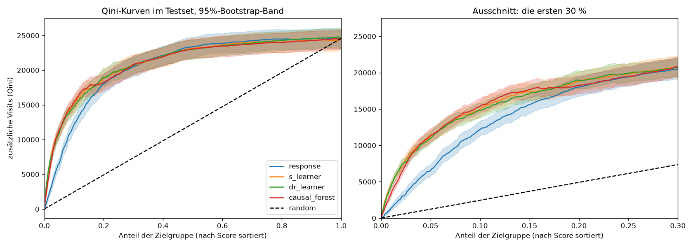
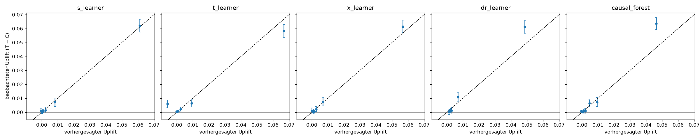
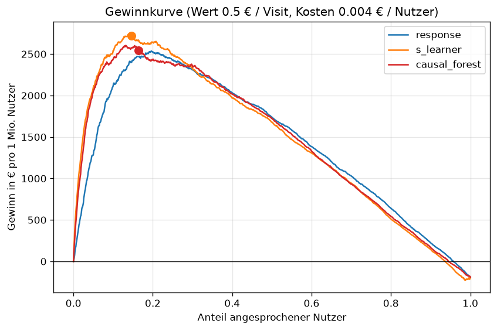
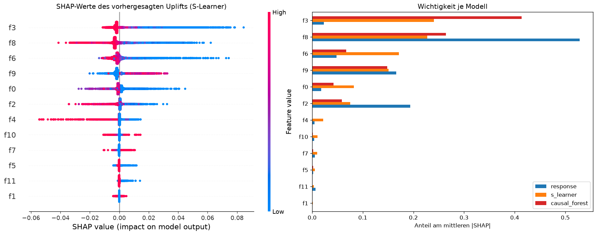

# Uplift-Modellierung: Wen soll eine Werbekampagne ansprechen?

**Kurzfassung:** Auf 14 Mio. Nutzern des Criteo-Uplift-Datensatzes finden Uplift-Modelle die Nutzer, die *wegen* der Werbung kommen. Mit den besten 10 % der Zielgruppe erreicht der S-Learner 77 % aller zusätzlichen Visits, ein klassisches Response-Modell („wer kommt am wahrscheinlichsten?“) 66 %. Unter beispielhaften Kosten lohnt es sich nicht, alle Nutzer anzusprechen (−190 € pro 1 Mio. Nutzer); die Regel „ansprechen, wenn vorhergesagter Uplift × Wert > Kosten“ wählt 15 % aus und erzielt +2.700 €. Der Vorsprung gegenüber dem Response-Modell ist statistisch gesichert, aber klein, und wächst, je knapper das Budget ist.



*Qini-Kurve: x-Achse = Anteil der angesprochenen Nutzer (sortiert nach Modell-Score), y-Achse = dadurch gewonnene zusätzliche Visits im Testset. Je steiler der Anfang, desto besser das Modell. Bänder = 95%-Bootstrap-Intervalle.*

## Inhalt

1. [Geschäftsfrage](#1-geschäftsfrage)
2. [Daten und Prüfung des Experiments](#2-daten-und-prüfung-des-experiments)
3. [Methoden](#3-methoden)
4. [Ergebnisse](#4-ergebnisse)
5. [Einschränkungen](#5-einschränkungen)
6. [Reproduktion](#6-reproduktion)
7. [Projektstand und Struktur](#7-projektstand-und-struktur)

## 1. Geschäftsfrage

Das Werbebudget reicht nicht für alle Nutzer. Gesucht sind die Nutzer, die **wegen** der Werbung kommen, nicht die, die ohnehin gekommen wären. Ein Response-Modell sagt vorher, wer einen Visit erzeugt; ein Uplift-Modell schätzt, um wie viel die Werbung diese Wahrscheinlichkeit erhöht:

```
Uplift(x) = P(visit | x, Werbung) − P(visit | x, keine Werbung)
```

Der individuelle Uplift ist nie direkt beobachtbar: Jeder Nutzer ist entweder in der Treatment- oder in der Kontrollgruppe. Deshalb braucht es ein randomisiertes Experiment und spezielle Evaluationsverfahren (Qini, Kalibrierung nach Gruppen).

## 2. Daten und Prüfung des Experiments

**Datensatz:** [Criteo Uplift v2.1](https://ailab.criteo.com/criteo-uplift-prediction-dataset/), 13.979.592 Nutzer, 12 anonymisierte numerische Merkmale (`f0`–`f11`), Treatment-Anteil 85 %. Laut Criteo ist der Datensatz aus mehreren Incrementality-Tests zusammengesetzt und für den Datenschutz ungleichmäßig unterabgetastet. Absolute Effektgrößen sind daher nicht als reale Werbewirkung zu lesen.

| Kennzahl | Kontrolle | Treatment |
|---|---|---|
| Visit-Rate | 3,82 % | 4,85 % |
| Conversion-Rate | 0,19 % | 0,31 % |
| Anzeige tatsächlich gesehen (`exposure`) | 0 % | 3,6 % |

Zielgröße ist `visit`. Conversions sind zu selten (nur 4.063 in der Kontrollgruppe), um individuelle Effekte verlässlich zu lernen.

**Balance-Check** ([Notebook 01](notebooks/01_eda_randomization.ipynb)): Alle standardisierten Mittelwertdifferenzen liegen unter 0,05. Ein Klassifikator, der aus den Merkmalen das Treatment vorhersagen soll, erreicht AUC 0,51, also kaum besser als Raten.

**Aber: Der Treatment-Anteil hängt leicht mit der Grundrate zusammen** ([Notebook 04](notebooks/04_evaluation_policy.ipynb)). Unter den 10 % Nutzern mit der höchsten Visit-Wahrscheinlichkeit sind 86,2 % behandelt statt 85,0 % ± 0,13 %. Dadurch überschätzt die einfache Differenz der Mittelwerte den Effekt:

| Schätzer für den durchschnittlichen Effekt (ATE) auf `visit` | Wert | 95%-KI |
|---|---|---|
| Differenz der Mittelwerte | 1,03 Pp. | 1,01 – 1,06 |
| Regressionsadjustiert (Lin 2013, alle 12 Merkmale) | 0,77 Pp. | 0,75 – 0,80 |
| Inverse Propensity-Gewichtung (IPW, Testset) | 0,76 Pp. | – |
| Innerhalb von 100 Grundraten-Gruppen (Testset) | 0,66 Pp. | – |
| Mittlere Vorhersage der Uplift-Modelle | 0,65 – 0,74 Pp. | – |

Die adjustierten Werte und die Modelle stimmen überein. Die Zeilenreihenfolge der Rohdatei enthält Blöcke mit 0 %, 27 % oder 100 % Treatment. Das passt dazu, dass die zusammengeführten Tests unterschiedliche Treatment-Anteile hatten; innerhalb eines Tests ist die Zuteilung zufällig, im gepoolten Datensatz nur bedingt auf die Merkmale. **Als Hauptschätzer dient daher der adjustierte ATE von 0,77 Pp.** (relativer Lift ≈ 20 % statt der naiven 27 %). Alle Geldbeträge in Abschnitt 4 sind mit IPW geschätzt.

**Effekt auf tatsächlich exponierte Nutzer** ([Notebook 02](notebooks/02_ate_iv.ipynb)): In der Kontrollgruppe sieht niemand die Anzeige (einseitige Non-Compliance). Mit dem Treatment als Instrument für `exposure` (Wald-/Bloom-Schätzer) ergibt sich auf Basis der naiven ITT ein Effekt von 28,7 Pp. (95%-KI 27,9 – 29,5). Mit der adjustierten ITT sind es grob 21 Pp. Die Werbung wirkt also stark bei den wenigen, die sie sehen. Für die Budgetplanung zählt trotzdem die ITT, denn gesteuert wird die Zuteilung, nicht das Sehen.

## 3. Methoden

Aufteilung 60/20/20 (Train/Validierung/Test), geschichtet nach Treatment × Visit. Alle Modelle werden auf demselben Testset (2,8 Mio. Nutzer) verglichen; Hyperparameter werden nur auf dem Validierungsset gewählt. Basismodell ist überall LightGBM ([`src/uplift/models.py`](src/uplift/models.py)).

| Modell | Idee | Warum hier |
|---|---|---|
| Zufall | zufällige Reihenfolge | untere Referenz |
| Response | P(visit \| x) nur auf Behandelten | Standardansatz im Marketing; Vergleich „Wer kommt?“ vs. „Wer kommt wegen der Werbung?“ |
| S-Learner | ein Modell mit Treatment als Merkmal | einfach, nutzt alle Daten |
| T-Learner | je ein Modell für Treatment und Kontrolle | einfach, aber leidet unter der kleinen Kontrollgruppe (15 %) |
| X-Learner | imputierte individuelle Effekte, gewichtet mit Propensity Score | für unbalancierte Gruppen entworfen (Künzel et al. 2019) |
| DR-Learner (EconML) | doppelt robustes Pseudo-Outcome, Cross-Fitting | robust, falls Outcome- oder Propensity-Modell falsch ist; 2 Mio. Teilstichprobe |
| Causal Forest (EconML) | Wald, der nach Effektunterschieden teilt | liefert Konfidenzintervalle pro Nutzer; 1 Mio. Teilstichprobe |

**Evaluation** ([`src/uplift/metrics.py`](src/uplift/metrics.py), [`src/uplift/policy.py`](src/uplift/policy.py)):

- **Qini-AUC:** Fläche zwischen Qini-Kurve und Zufallsgerade, normiert mit der Gesamtzahl zusätzlicher Visits. 0 = zufällig, größer = besser.
- **Uplift@k:** beobachtete Differenz der Visit-Raten (Treatment − Kontrolle) unter den Top-k % nach Score.
- **Bootstrap:** 200 gepaarte Poisson-Bootstrap-Runden auf dem Testset; alle Modelle sehen in jeder Runde dieselbe Stichprobe, sodass Modelldifferenzen direkt Intervalle bekommen.
- **Kalibrierung:** 10 gleich große Gruppen nach vorhergesagtem Uplift, vorhergesagt vs. beobachtet.
- **Budget und Gewinn:** zusätzliche Visits einer ausgewählten Gruppe per inverser Propensity-Gewichtung (IPW), damit absolute Zahlen nicht durch den schwankenden Treatment-Anteil verzerrt sind.
- **Effekttreiber:** SHAP-Werte eines Surrogat-Modells, das die Vorhersagen des jeweiligen Modells nachlernt (R² ≥ 0,985 auf ungesehenen Nutzern).
- Gleichstände im Score werden zufällig aufgelöst, weil die Zeilenreihenfolge der Datei mit Treatment und Visit zusammenhängt.

## 4. Ergebnisse

### Modellvergleich auf dem Testset

| Modell | Qini-AUC | 95%-KI | Δ zu Response (95%-KI) | Uplift@10 % |
|---|---|---|---|---|
| Zufall | −0,004 | −0,021 – 0,014 | – | 1,02 Pp. |
| Response | 0,341 | 0,332 – 0,352 | – | 5,05 Pp. |
| S-Learner | 0,359 | 0,341 – 0,376 | +0,018 (0,003 – 0,033) | 6,21 Pp. |
| T-Learner | 0,328 | 0,308 – 0,349 | −0,013 (−0,037 – 0,008) | 5,83 Pp. |
| X-Learner | 0,359 | 0,342 – 0,380 | +0,018 (0,002 – 0,036) | 6,15 Pp. |
| DR-Learner | 0,360 | 0,344 – 0,379 | +0,019 (0,000 – 0,036) | 6,11 Pp. |
| Causal Forest | 0,356 | 0,345 – 0,369 | +0,015 (0,005 – 0,027) | 6,36 Pp. |

- **Uplift schlägt Response.** S-, X-, DR-Learner und Causal Forest liegen in 98 – 99,5 % der Bootstrap-Runden vor dem Response-Modell.
- **Die vier guten Uplift-Modelle sind nicht unterscheidbar.** Gegenüber dem S-Learner enthalten alle Differenz-Intervalle die 0.
- **Der T-Learner fällt ab:** Sein Kontrollmodell lernt aus nur 1,3 Mio. Nutzern; die Differenz zweier unabhängig verrauschter Modelle verschlechtert die Rangfolge.
- **Der Causal Forest erreicht dasselbe Niveau mit einem Achtel der Trainingsdaten.**

### Kalibrierung



- **S- und X-Learner** liegen nahe der Diagonale: Ihre Vorhersagen taugen auch als absolute Zahlen.
- **DR-Learner und Causal Forest** unterschätzen die oberste Gruppe (Vorhersage ≈ 4,6 – 4,9 Pp., beobachtet ≈ 6,1 – 6,4 Pp.). Die starke Regularisierung zieht Extremwerte zur Mitte; die Rangfolge bleibt gut.
- **Der T-Learner** sagt für die unterste Gruppe −0,6 Pp. vorher, beobachtet sind +0,6 Pp.
- Für eine Kosten-Nutzen-Regel („Uplift × Wert > Kosten“) zählen absolute Werte, daher ist dafür ein gut kalibriertes Modell zu bevorzugen.

### Budget: Wie viel Wirkung bleibt bei kleinerer Zielgruppe?

Anteil aller zusätzlichen Visits (IPW-geschätzt; 100 % = alle ansprechen):

| Angesprochener Anteil | Zufall | Response | S-Learner | Causal Forest |
|---|---|---|---|---|
| Top 5 % | 3 % | 39 % | 60 % | 59 % |
| Top 10 % | 10 % | 66 % | 77 % | 75 % |
| Top 20 % | 20 % | 87 % | 90 % | 85 % |
| Top 30 % | 28 % | 92 % | 93 % | 93 % |

Der Vorteil der Uplift-Modelle liegt bei **kleinen Budgets**. Ab etwa 20 % der Zielgruppe sind die Unterschiede verschwunden: Hohe Visit-Wahrscheinlichkeit und hoher Uplift überschneiden sich in diesem Datensatz stark (Rangkorrelation Response vs. S-Learner 0,90).

### Ausspielungsregel und Gewinn

Beispielhafte Annahmen: Ein zusätzlicher Visit ist **0,50 €** wert, einen Nutzer anzusprechen kostet **0,004 €** (≈ 4 € pro 1.000 Nutzer). Regel: ansprechen, wenn vorhergesagter Uplift × 0,50 € > 0,004 €, also Uplift > 0,8 Pp. Die Schwelle liegt knapp über dem durchschnittlichen Effekt (0,76 Pp.), sodass sich „alle ansprechen“ gerade nicht mehr lohnt.

| Strategie (pro 1 Mio. Nutzer) | angesprochen | zusätzliche Visits | Gewinn |
|---|---|---|---|
| Niemanden ansprechen | 0 % | 0 | 0 € |
| Alle ansprechen | 100 % | 7.622 | −189 € |
| **Regel mit S-Learner** | 14,6 % | 6.612 | **+2.723 €** |
| Regel mit Causal Forest | 16,4 % | 6.396 | +2.541 € |
| Response-Modell, bester Anteil im Nachhinein¹ | 19,6 % | 6.639 | +2.535 € |
| S-Learner, bester Anteil im Nachhinein¹ | 14,1 % | 6.611 | +2.742 € |

¹ auf dem Testset nachträglich gewählt, also zu optimistisch. Das Response-Modell sagt keinen Uplift vorher und kann die Kosten-Nutzen-Regel nicht direkt anwenden.



- **Mit 15 % der Zielgruppe bleiben 87 % der zusätzlichen Visits**, aus einem Verlust wird ein Gewinn.
- **Die Regel trifft fast das Optimum:** Sie wird vorab festgelegt und liegt nur 0,7 % unter dem besten im Nachhinein gewählten Anteil, weil der S-Learner gut kalibriert ist. Mit den anderen Uplift-Modellen bringt dieselbe Regel 6 – 9 % weniger (2.500 – 2.570 €).
- Die Gewinnzahlen selbst sind verrauscht (grob ±200 €); der Abstand zwischen S-Learner und Response-Modell liegt in dieser Größenordnung.

**Sensitivität** ([Grafik](reports/figures/policy_sensitivity.png)): Die Entscheidung hängt nur vom Verhältnis Kosten / Wert ab. Steigt es von 0,1 % auf 5 %, sinkt der Anteil, den die Regel anspricht, von 35 % auf 4 %. Ab 0,76 % ist „alle ansprechen“ ein Verlustgeschäft. Bei knappem Budget (Verhältnis 4,4 %) erzielt die S-Learner-Regel das 2,4-Fache des besten Response-Anteils (2.410 vs. 1.005 Visit-Werte pro 1 Mio. Nutzer). Bei sehr günstiger Ausspielung (unter etwa 0,2 %) ist das Response-Ranking gleich gut oder leicht besser.

### Was treibt den Uplift?

Anteil am mittleren |SHAP| je Modell ([Notebook 05](notebooks/05_heterogeneity.ipynb)):

| Merkmal | Response („wer kommt?“) | S-Learner (Uplift) | Causal Forest (Uplift) |
|---|---|---|---|
| f3 | 2 % | 24 % | 41 % |
| f8 | 53 % | 23 % | 26 % |
| f6 | 5 % | 17 % | 7 % |
| f9 | 17 % | 15 % | 15 % |
| f2 | 19 % | 8 % | 6 % |



**f3 spielt für „wer kommt?“ kaum eine Rolle, ist aber der wichtigste Treiber für „wer kommt wegen der Werbung?“.** Zwei grundverschiedene Uplift-Modelle (Boosting und Wald) wählen dieselben vier Merkmale. Die Rohdaten bestätigen das Muster:

| f3 (Gruppen) | Anteil Nutzer | Visit-Rate Kontrolle | beobachteter Uplift | Vorhersage S-Learner |
|---|---|---|---|---|
| ≤ 0,30 | 3,7 % | 13,3 % | 9,1 Pp. (± 0,6) | 7,3 Pp. |
| 0,30 – 1,82 | 3,8 % | 9,8 % | 5,0 Pp. | 3,7 Pp. |
| 1,82 – 2,94 | 4,3 % | 8,3 % | 3,0 Pp. | 2,2 Pp. |
| 2,94 – 3,91 | 6,3 % | 6,5 % | 1,3 Pp. | 1,2 Pp. |
| = 4,68 (häufigster Wert) | 81,8 % | 2,8 % | 0,2 Pp. | 0,2 Pp. |

Die 18 % Nutzer mit niedrigem f3 tragen fast die gesamte Wirkung; bei den übrigen 82 % ändert die Werbung kaum etwas.

## 5. Einschränkungen

- **Anonymisierte Merkmale:** Es lässt sich nicht sagen, *welche Art* von Nutzern gut reagiert („niedriges f3“), nur *dass* die Modelle sie finden.
- **Unterabtastung durch Criteo:** Absolute Raten und Effektgrößen sind nicht repräsentativ; belastbar sind Vergleiche zwischen Modellen.
- **Gepoolte Tests:** Der Treatment-Anteil hängt leicht mit den Merkmalen zusammen (s. Abschnitt 2). Budget und Gewinn sind deshalb mit IPW geschätzt; Qini, Bootstrap und Kalibrierung vergleichen dagegen ungewichtet innerhalb der Top-k bzw. der Gruppen.
- **Annahmen zu Kosten und Wert** sind frei gewählt; die Sensitivitätsanalyse zeigt, wie sich die Empfehlung mit ihnen ändert.
- **Kleiner Abstand:** Der Vorsprung gegenüber dem Response-Modell ist gesichert, aber in der Größenordnung von 5 % Qini. Ob er sich lohnt, hängt vom Budget ab.
- **Bootstrap-Intervalle** erfassen nur die Unsicherheit des Testsets, nicht die des Trainings; für die Gewinnzahlen gibt es nur eine grobe Fehlerabschätzung.
- **SHAP erklärt die Modelle**, nicht direkt die Kausalstruktur; die Gegenprobe mit den Rohdaten stützt aber das Muster für f3.
- **Teilstichproben:** DR-Learner (2 Mio.) und Causal Forest (1 Mio.) wurden wegen Speicher und Laufzeit nicht auf allen Trainingsdaten angepasst.

## 6. Reproduktion

Voraussetzungen: Python 3.11, [uv](https://docs.astral.sh/uv/), ca. 16 GB RAM.

1. Umgebung anlegen:

   ```bash
   uv sync
   ```

2. Daten herunterladen (ca. 310 MB, nicht im Repository) und als `data/raw/criteo-research-uplift-v2.1.csv.gz` ablegen: http://go.criteo.net/criteo-research-uplift-v2.1.csv.gz

3. In Parquet umwandeln (Merkmale als float32, Labels als int8):

   ```bash
   uv run python scripts/convert_to_parquet.py
   ```

4. Die Notebooks in Reihenfolge ausführen: `01` → `02` → `03` → `04` → `05`. Notebook 03 trainiert alle Modelle (ca. 15 Minuten) und speichert die Testvorhersagen nach `data/processed/preds_test.parquet`, die Notebooks 04 und 05 lesen. Notebook 04 braucht für den Bootstrap ca. 5 Minuten.

## 7. Projektstand und Struktur

```
├── notebooks/
│   ├── 01_eda_randomization.ipynb   # Überblick, Balance-Check
│   ├── 02_ate_iv.ipynb              # ATE (naiv und adjustiert), IV-Schätzung
│   ├── 03_uplift_models.ipynb       # alle Modelle, Vergleich auf dem Testset
│   ├── 04_evaluation_policy.ipynb   # Bootstrap, Kalibrierung, Budget, Gewinn, Sensitivität
│   └── 05_heterogeneity.ipynb       # SHAP: Was treibt den Uplift?
├── src/uplift/
│   ├── metrics.py                   # Qini, AUUC, Uplift@k, Bootstrap, Kalibrierung
│   ├── models.py                    # LightGBM-Bausteine, S-/T-/X-Learner, EconML-Modelle
│   └── policy.py                    # IPW-Schätzung zusätzlicher Visits, Budgetkurve
├── scripts/convert_to_parquet.py    # CSV → Parquet
└── reports/                         # Ergebnistabellen (CSV) und Abbildungen
```

| Schritt | Stand |
|---|---|
| Experiment prüfen, ATE und IV | ✅ |
| 6 Modelle + Zufall auf demselben Testset | ✅ |
| Qini mit Bootstrap-Intervallen, Kalibrierung | ✅ |
| Budgetkurve, Ausspielungsregel, Sensitivitätsanalyse | ✅ |
| Effekttreiber (SHAP) | ✅ |
| Logik aus den Notebooks nach `src/` verschieben | ✅ |

## Quelle und Lizenz der Daten

Diemert, E., Betlei, A., Renaudin, C., Amini, M.-R. (2018): *A Large Scale Benchmark for Uplift Modeling.* AdKDD & TargetAd Workshop, KDD 2018, London.

Die Daten stehen unter [CC BY-NC-SA 4.0](https://creativecommons.org/licenses/by-nc-sa/4.0/) und werden hier nicht weiterverteilt.
